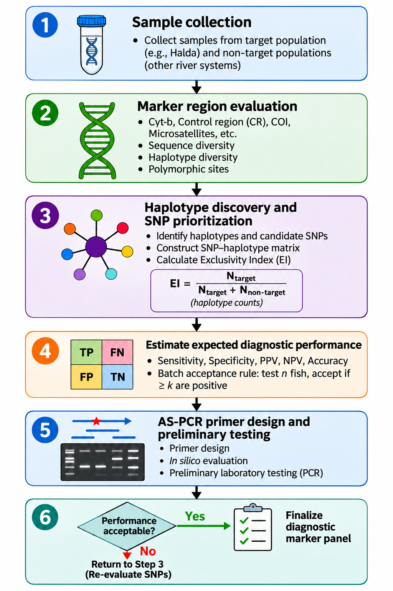

# HapTrace

**A haplotype-guided pipeline for population-of-origin tracing, with a case study of Halda-origin rohu (*Labeo rohita*).**

This repository contains the input data, R code and results for the manuscript:

> Ahmed K.A., Rahman M.M., Rabbane M.G. & Alam M.S. *HapTrace: a haplotype-guided pipeline for population-of-origin tracing, with a case study of Halda-origin rohu,* Labeo rohita. (in preparation)

HapTrace links mitochondrial haplotype analysis to SNP prioritisation, sequence-based diagnostic evaluation, hierarchical screening and a simple batch-level acceptance rule that tells a buyer how many fish to test.

<p align="center">
  
</p>
<p align="center"><em>The HapTrace framework (Fig. 1 of the manuscript).</em></p>

## Repository structure

```
HapTrace_repo/
├── run_all.R                     # runs the whole analysis
├── docs/HapTrace_framework.png   # framework figure shown above
├── R/
│   ├── 00_setup.R                # settings (target population, SNP panel) and helper functions
│   ├── 01_snp_matrix_ei.R        # SNP-haplotype matrix and Exclusivity Index (EI)
│   ├── 02_diversity.R            # Table S1 (diversity) and Table S2 (haplotype distribution)
│   ├── 03_snp_performance.R      # Tables 2-4 (SNP distribution, diagnostic performance, hierarchical screening)
│   ├── 04_batch_rule.R           # batch acceptance rule (Section 4.7) and Fig. 3
│   └── 05_figS1_tree.R           # Fig. S1 (ML tree of haplotypes with >= 2 individuals)
├── data/
│   ├── CR_haplotypes.fasta       # 50 mitochondrial control-region haplotypes (594-bp alignment)
│   ├── haplotype_counts.csv      # individuals per haplotype in Padma, Jamuna, Halda and Culture (n = 166)
│   └── ASPCR_primers.csv         # allele-specific PCR primers (Table S3)
├── mega/
│   ├── ML_T92G_1000bs.mao        # MEGA-CC settings (ML, Tamura 3-parameter + G, 1000 bootstraps)
│   ├── CR_haplotypes_n2plus.fasta    # 19 haplotypes with >= 2 individuals (written by step 5)
│   ├── CR_19haplotypes_ML.nwk    # resulting ML tree with bootstrap support
│   └── CR_19haplotypes_ML_summary.txt
└── results/
    ├── tables/                   # all tables (CSV)
    ├── figures/                  # Fig. 3 and Fig. S1 (PNG, PDF)
    └── sessionInfo.txt
```

## Input data

| File | Content |
|---|---|
| `data/CR_haplotypes.fasta` | Aligned control-region haplotypes `Hap_01`–`Hap_50` (594 bp). |
| `data/haplotype_counts.csv` | Columns `Haplotypes, All, Padma, Jamuna, Halda, Culture`: number of individuals carrying each haplotype (Padma 40, Jamuna 48, Halda 46, Culture 32). Haplotype names match the FASTA. |

**Coordinates.** SNPs are labelled with manuscript positions (e.g. `460C`), which equal the position in `CR_haplotypes.fasta` + 4 (`POS_OFFSET` in `R/00_setup.R`).

## How to run

Requirements: R ≥ 4.1. Base R is sufficient for all tables; `ggplot2` draws Fig. 3; `ape` and `ggtree` (Bioconductor) draw Fig. S1.

```r
install.packages(c("ggplot2", "ape"))
if (!requireNamespace("BiocManager", quietly = TRUE)) install.packages("BiocManager")
BiocManager::install("ggtree")
```

From the repository root:

```bash
Rscript run_all.R
```

Each step can also be run separately (e.g. `Rscript R/04_batch_rule.R`). To apply HapTrace to another species or target population, replace the two input files and edit `TARGET`, `POPS`, `PANEL`, `SPECIFIC` and `POS_OFFSET` in `R/00_setup.R`.

The ML tree for Fig. S1 was inferred with MEGA-CC 10.2.6 (model selected by BIC):

```bash
megacc -a mega/ML_T92G_1000bs.mao -d mega/CR_haplotypes_n2plus.fasta -o mega/CR_19haplotypes_ML
```

## Outputs and manuscript items

| Output (`results/`) | Manuscript |
|---|---|
| `tables/SNP_haplotype_matrix.csv` | SNP–haplotype matrix (48 polymorphic sites) |
| `tables/Exclusivity_index_all_alleles.csv` | EI and individual counts for every allele |
| `tables/TableS1_diversity.csv` | Table S1 |
| `tables/TableS2_haplotype_distribution.csv` | Table S2 |
| `tables/Table2_SNP_haplotype_distribution.csv` | Table 2 |
| `tables/Table3_diagnostic_performance.csv` | Table 3 |
| `tables/Table4_hierarchical_screening.csv` | Table 4 |
| `tables/Batch_detection_summary.csv`, `Batch_acceptance_rules.csv`, `Batch_acceptance_curves.csv` | Section 4.7 |
| `figures/Fig3_batch_acceptance_rule.*` | Fig. 3 |
| `figures/FigS1_ML_tree.*` | Fig. S1 |

## Methods in brief

- **Exclusivity Index (EI):** for each allele, the number of target-population haplotypes carrying it divided by all haplotypes carrying it. EI is a haplotype-level measure and is distinct from individual-level diagnostic specificity.
- **Diagnostic performance:** haplotype allele states are converted to individual-level TP/FN/FP/TN using the haplotype counts; sensitivity, specificity, PPV, NPV and accuracy follow standard definitions. In hierarchical screening, metrics after step 1 are conditional on the samples negative at all previous steps. All values are within-sample (apparent) estimates.
- **Batch acceptance rule:** a batch is accepted as target origin if at least *k* of *n* tested fish carry a target-specific allele. With the binomial distribution, P(accept | target batch) = P(X ≥ k | n, p<sub>T</sub>) and P(accept | non-target batch) = P(X ≥ k | n, p<sub>N</sub>). For the four Halda-specific SNPs, p<sub>T</sub> = 11/46 (95% Clopper–Pearson CI 12.6–38.8%); no non-Halda fish carried these alleles (0/120; upper 95% limit 3.0%). **Testing 18 fish and accepting the batch if two or more are positive accepts 95% of Halda-origin batches; the chance of accepting a non-Halda batch is 0.4%, 1.4% or 10% at false-positive rates of 0.5%, 1% or 3.0%.** Using the lower confidence limit of p<sub>T</sub>, 36 fish are needed. The rule assumes independently sampled fish (siblings share mitochondrial haplotypes) and indicates the presence of Halda maternal lineages, not the origin of every fish.

## Citation and licence

Please cite the article above when using this code or data. A licence will be added on publication.
